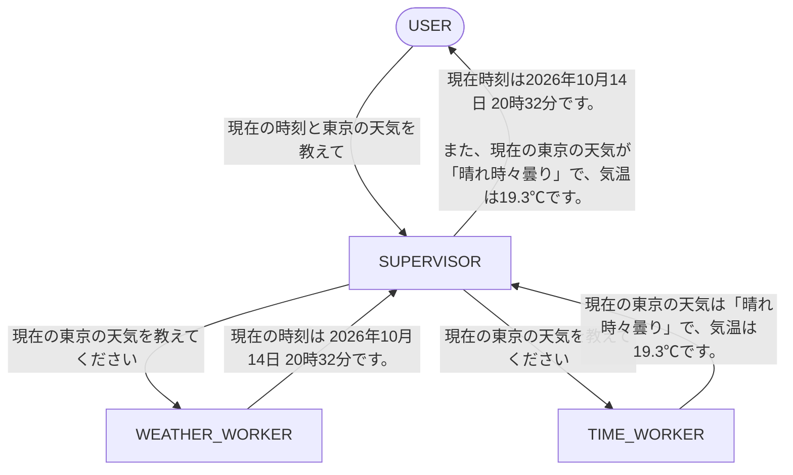
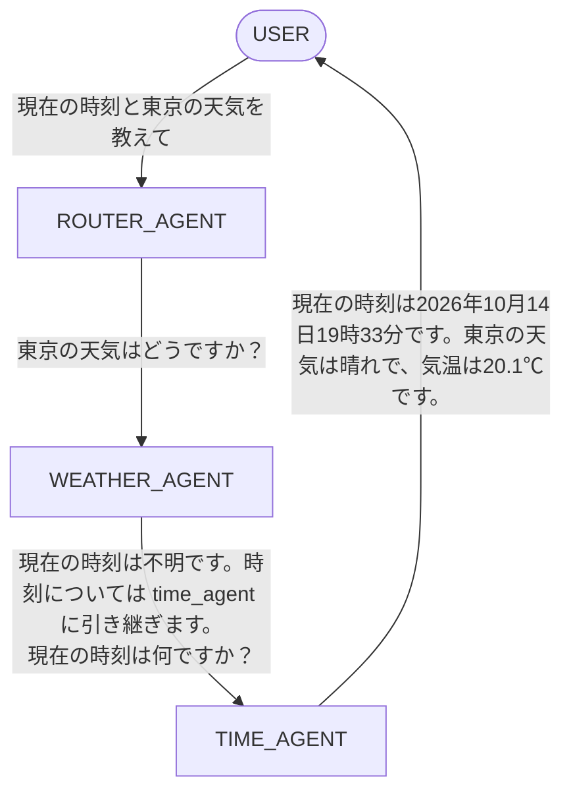

# Agent as Tool / Handoff

LangGraph で実装する 2 つのマルチエージェント構成 **Agent as Tool**(Supervisor 型)と **Handoff**(制御移譲型)の比較用サンプルです。LLM は [Ollama](https://ollama.com/) 経由でローカル実行します。

同じ質問「現在の時刻と東京の天気を教えて」に対して、両パターンがどのようにエージェント間でやり取りするかを確認できます。

| | Agent as Tool | Handoff |
|---|---|---|
| 制御の主体 | Supervisor が常に保持 | 現在のエージェントが次のエージェントへ移譲 |
| ワーカーの扱い | Supervisor から呼ばれる「ツール」 | 対等なエージェント |
| 最終応答の返し手 | Supervisor | 最後に制御を受け取ったエージェント |
| 実行スクリプト | `agent-as-tool.py` | `handoff.py` |

## 前提条件

- Python 3.10 以上(推奨)
- [Ollama](https://ollama.com/download)

## セットアップ

### 1. Ollama のインストールとモデル取得

[https://ollama.com/download](https://ollama.com/download) からインストールします。インストール後、ターミナルを再起動して Ollama サーバーを起動します(デスクトップアプリ版で既に常駐している場合は不要です)。

```bash
ollama serve
```

使用するモデルを取得します (このコードでは `qwen3.5:9b` を使用してます)。

```bash
ollama pull qwen3.5:9b
```

### 2. Python パッケージのインストール

```bash
pip install langchain-core langchain-ollama langgraph yaspin
```

## Agent as Tool

Supervisor が各ワーカーエージェントをツールとして呼び出し、結果を集約してユーザーに返します。

```bash
python agent-as-tool.py
```



実行例:

```text
[USER] 現在の時刻と東京の天気を教えて -> [SUPERVISOR]
[SUPERVISOR] 現在の時刻を教えてください -> [TIME_WORKER]
[SUPERVISOR] 現在の東京の天気を教えてください -> [WEATHER_WORKER]
[TIME_WORKER] 現在の時刻は 2026年10月14日 20時32分です。 -> [SUPERVISOR]
[WEATHER_WORKER] 現在の東京の天気は「晴れ時々曇り」で、気温は19.3℃です。 -> [SUPERVISOR]
[SUPERVISOR] 現在時刻は 2026年10月14日 20時32分です。
また、現在の東京の天気は「晴れ時々曇り」で、気温は 19.3℃ です。 -> [USER]
```

## Handoff

ROUTER_AGENT が最初のエージェントへ処理を渡し、各エージェントは自分の担当外の内容を別のエージェントへ引き継ぎます。最後のエージェントがユーザーへ直接回答します。

```bash
python handoff.py
```



実行例:

```text
[USER] 現在の時刻と東京の天気を教えて -> [ROUTER_AGENT]
[ROUTER_AGENT] 東京の天気はどうですか? -> [WEATHER_AGENT]
[WEATHER_AGENT] 現在の時刻は不明です。時刻については time_agent に引き継ぎます。
[WEATHER_AGENT] 現在の時刻は何ですか? -> [TIME_AGENT]
[TIME_AGENT] 現在の時刻は2026年10月14日19時33分です。東京の天気は晴れで、気温は20.1℃です。 -> [USER]
```

> 実行例の時刻・天気の値は実行ごとに異なります。また、LLM の出力は非決定的なため、同じ入力でも文面やルーティングが変わることがあります。

## 補足

- Ollama はモデルの取得・管理、推論の実行、ローカル API サーバーの提供を担います。GPU が利用可能な環境では自動的に利用されます。
- 別のモデルを使う場合は `ollama pull <model>` で取得し、スクリプト内のモデル名を変更してください。